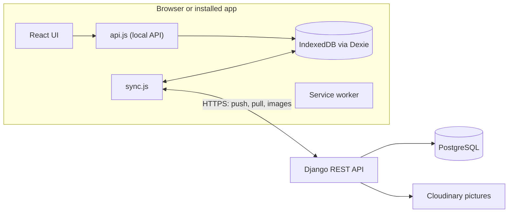

My Grocery Shopper
A personal grocery shopping app that works offline. Keep your own price list with pictures, build a cart for each shop visit, edit prices as they change, and see where your money goes. It installs on a phone like a native app and syncs to the cloud whenever a connection is available.
Live demo: https://YOUR-APP.onrender.com (replace with your deployed site address)


Features
Your own shelf. Add products with a picture, category, unit (kg, bag, tin...), default quantity and price.
Price tracking. Edit a price whenever it changes. Every change is recorded, and each product shows a rise or fall badge.
Shopping cart. Tap products on the dashboard to add them. Adjust quantity and the price you actually see in the shop.
Budget meter. Set a budget per trip and watch the remaining amount. It warns you at 90% and when you go over.
Trip history. Finished trips keep the prices you paid. Repeat a past trip with one tap.
Stats. Monthly spending, spending by category, most-bought items, and a "where is it cheapest?" store comparison per product.
Works offline. Everything is stored on the device first. Changes sync automatically when you are back online.
Installable (PWA) with a mobile-first layout and a bottom tab bar on phones.
Accounts. Each person only ever sees their own data.
How it works

The app is offline-first. The screens read and write a database inside the browser, so they never wait for the network. A background sync sends local changes to the server and receives changes made elsewhere. See docs/ARCHITECTURE.md for the details.
Tech stack
Layer	Technology
Frontend	React 19, Vite 8, React Router 7, lucide-react icons
Offline	Dexie (IndexedDB), vite-plugin-pwa (service worker, installable app)
Backend	Python 3.13, Django 6.1, Django REST Framework (token auth)
Database	PostgreSQL
Pictures	Cloudinary (local disk in development)
Hosting	Render (API and static site), Neon (database)
Quick start
You need Python 3.12+, Node.js 20.19+ (or 22.12+), and a running PostgreSQL.
```bash
git clone https://github.com/Zeehy123/MPshopper.git
cd MPshopper
```
Backend
```bash
cd backend
python -m venv venv
source venv/bin/activate          # Windows: venv\Scripts\activate
pip install -r requirements.txt
cp .env.example .env              # then edit DATABASE_URL
python manage.py migrate
python manage.py createsuperuser
python manage.py runserver
```
Frontend (in a second terminal)
```bash
cd frontend
npm install
cp .env.example .env              # VITE_API_URL=http://127.0.0.1:8000/api
npm run dev
```
Open http://localhost:5173, create an account, and add a product. Full setup notes and troubleshooting are in docs/DEVELOPMENT.md.
Project structure
```
MPshopper/
├── backend/                 Django API
│   ├── config/              settings, root URLs
│   └── shop/                models, sync endpoints, accounts, admin
├── frontend/                React app (PWA)
│   └── src/
│       ├── pages/           Dashboard, Add product, Cart, History, Stats, Login
│       ├── components/      ProductCard, CartItemRow, SyncStatus, Navbar...
│       ├── context/         Auth and Cart state
│       ├── api.js           the app's data layer (reads and writes IndexedDB)
│       ├── db.js            Dexie schema and outbox helpers
│       ├── sync.js          push, pull and image upload
│       └── auth.js          login and token storage
└── docs/                    architecture, API, development, deployment
```
Documentation
Document	What is in it
Architecture	Offline-first design, data model, sync algorithm, security
API reference	Every endpoint with request and response examples
Development guide	Local setup, environment variables, common problems
Deployment guide	Render, Neon and Cloudinary, step by step
Known limitations
Conflicts are resolved by last edit wins. That is fine for one person on a few devices, but it is not a collaborative editor.
On the free hosting plan the API sleeps when idle, so the first sync after a quiet spell can take up to a minute. The app itself still opens and works offline.
Products can be created and re-priced, but there is no screen yet to rename or delete them.
There is no password reset yet.
Roadmap
Meal planner that builds a list from recipes, pantry tracking, shared family lists, barcode scanning, client-side image compression, automated tests.
Author
Built by Zainab Yusuf (@Zeehy123).
